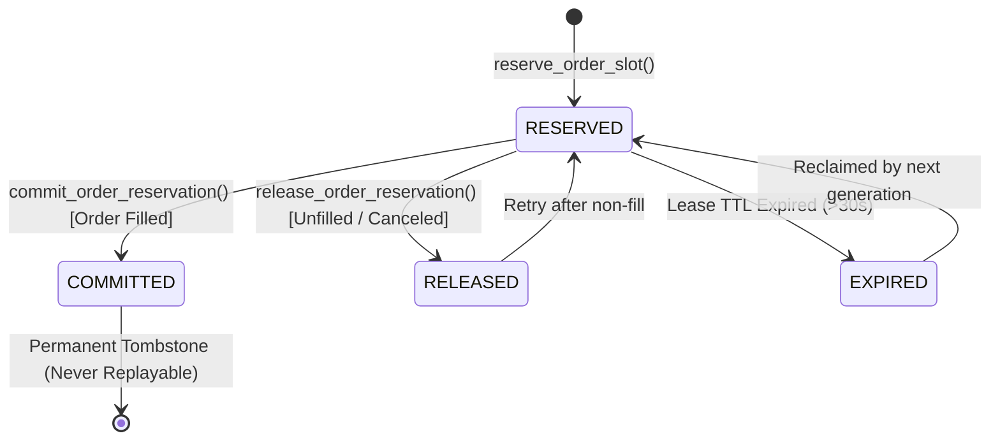

# Durable Idempotency Registry Design & Architecture (Phase 3.29)

**Target Component:** [`services/idempotency_registry.py`](file:///C:/Users/ajith/Downloads/Local_AI_Agent/services/idempotency_registry.py)  
**Consumer:** [`services/delta_paper_broker.py`](file:///C:/Users/ajith/Downloads/Local_AI_Agent/services/delta_paper_broker.py)  
**Storage Engine:** SQLite (WAL Mode, `busy_timeout=10000ms`, `synchronous=NORMAL`)  
**Data Integrity:** ACID-compliant, PRIMARY KEY Unique Constraint, Multi-Process Protected.

---

## 1. Architectural Overview

Phase 3.28 identified an idempotency retention vulnerability: when `_processed_idempotency_keys` exceeded 1,000 keys, FIFO eviction pruned the oldest keys from memory and `state.json`. If an identical idempotency key was replayed after being pruned, the broker permitted re-execution once the account was flat.

To permanently remediate this vulnerability, Phase 3.29 introduces a **Durable Idempotency Registry** backed by an ACID-compliant SQLite database adjacent to the broker's state file (`{state_file}.idempotency.db`).

```
+--------------------------------------------------------------------------------------------------+
|                            THREE-TIER DEDUPLICATION ARCHITECTURE                                 |
+--------------------------------------------------------------------------------------------------+
                                     Incoming Order Request
                                                │
                                                ▼
                         ┌──────────────────────────────────────────────┐
                         │   L1: In-Memory Fast-Path Cache              │
                         │   (Up to 1,000 newest keys in memory)        │
                         └──────────────────────┬───────────────────────┘
                                                │ Not Found in L1
                                                ▼
                         ┌──────────────────────────────────────────────┐
                         │   L2: Durable SQLite Registry                │
                         │   (Permanent, ACID, Unbounded Key Store)     │
                         └──────────────────────┬───────────────────────┘
                                                │ Not Found in L2
                                                ▼
                         ┌──────────────────────────────────────────────┐
                         │   L3: Historical Closed Trades Ledger        │
                         │   (Permanent append-only JSON trade history) │
                         └──────────────────────┬───────────────────────┘
                                                │ Not Found in L3
                                                ▼
                                    Grant Order Slot Reservation
```

---

## 2. Database Schema & Indexing

The registry manages the `idempotency_records` table:

```sql
CREATE TABLE IF NOT EXISTS idempotency_records (
    idempotency_key TEXT PRIMARY KEY NOT NULL,
    status TEXT NOT NULL,         -- 'RESERVED', 'COMMITTED', 'RELEASED', 'EXPIRED'
    token TEXT,                   -- Reservation lease token: RES_GEN{gen}_{hex}
    generation INTEGER,           -- Monotonically increasing fencing counter
    strategy_name TEXT,
    symbol TEXT,
    direction TEXT,
    order_id TEXT,
    trade_id TEXT,
    created_at TEXT NOT NULL,     -- ISO-8601 UTC timestamp
    updated_at TEXT NOT NULL,     -- ISO-8601 UTC timestamp
    expires_at REAL,              -- Epoch timestamp when reservation lease expires
    metadata_json TEXT            -- Serialized execution details & fill pricing
);

CREATE INDEX IF NOT EXISTS idx_idemp_status ON idempotency_records(status);
CREATE INDEX IF NOT EXISTS idx_idemp_token ON idempotency_records(token);
```

### Constraints & Invariants
1. `PRIMARY KEY (idempotency_key)` guarantees that duplicate records cannot physically exist in the database.
2. `COMMITTED` records are **immutable and permanent**. Commits cannot be overwritten, purged by FIFO pruning, or canceled.
3. `RESERVED` records contain a lease timestamp (`expires_at`). If an uncontended or abandoned reservation expires, subsequent workers can safely claim the slot.
4. Auto-WAL (`PRAGMA journal_mode = WAL`) enables non-blocking concurrent reads and resilient crash durability without database locking deadlocks.

---

## 3. Order Lifecycle & State Transitions



1. **Reservation Phase (`reserve`):**
   - Broker acquires `CrossProcessReentrantLock`.
   - Registry verifies whether `idempotency_key` is `COMMITTED`. If committed, returns `False` immediately.
   - If `RESERVED` and `now < expires_at`, returns `False` (in-flight concurrency conflict).
   - If new (or previous reservation expired / released), inserts or updates `status = 'RESERVED'`.
2. **Commit Phase (`commit`):**
   - Order simulation fills successfully.
   - Broker commits reservation token.
   - Registry verifies token is valid, matches generation, and `now < expires_at`.
   - Transitions `status = 'COMMITTED'`, records `order_id` and `trade_id`.
   - Commits SQLite transaction.
   - Broker assigns `open_position` and updates cash ledger.
3. **Release Phase (`release`):**
   - If order is unfilled (e.g. limit price not reached, zero fill, insufficient margin), reservation is explicitly released with reason.
   - Registry transitions `status = 'RELEASED'`.

---

## 4. Multi-Process Concurrency & Synchronization

Deduplication across separate OS processes is protected by two defense layers:
1. **OS Kernel Lock (`CrossProcessReentrantLock`):** Serializes broker entry points across separate processes on the operating system.
2. **SQLite Database Engine Locks & Transactions:**
   - WAL mode with `busy_timeout = 10000ms`.
   - `sqlite3.IntegrityError` handling: If two processes simultaneously attempt to insert the same key, SQLite's atomic B-tree unique constraint forces exactly one process to succeed and the second to receive an integrity collision, which the registry converts into a deterministic duplicate rejection.

---

## 5. Crash Recovery & Auto-Healing

- **Process Crash During Write:** SQLite WAL guarantees full ACID atomicity. Interrupted transactions roll back cleanly without partial or phantom state.
- **Process Crash After Commit Before Acknowledgement:** Because commit is persisted in SQLite before acknowledgement, a client retrying the order will find `COMMITTED` in SQLite and receive an immediate duplicate rejection, preventing double execution.
- **Corrupt SQLite File Recovery:** If the `.idempotency.db` file is corrupted with invalid or truncated bytes, `_init_db()` automatically isolates the damaged file to `.corrupt.<timestamp>`, initializes a clean database, and triggers `sync_historical_keys()` to backfill all historical trade IDs from `closed_trades` and `_processed_idempotency_keys`.
