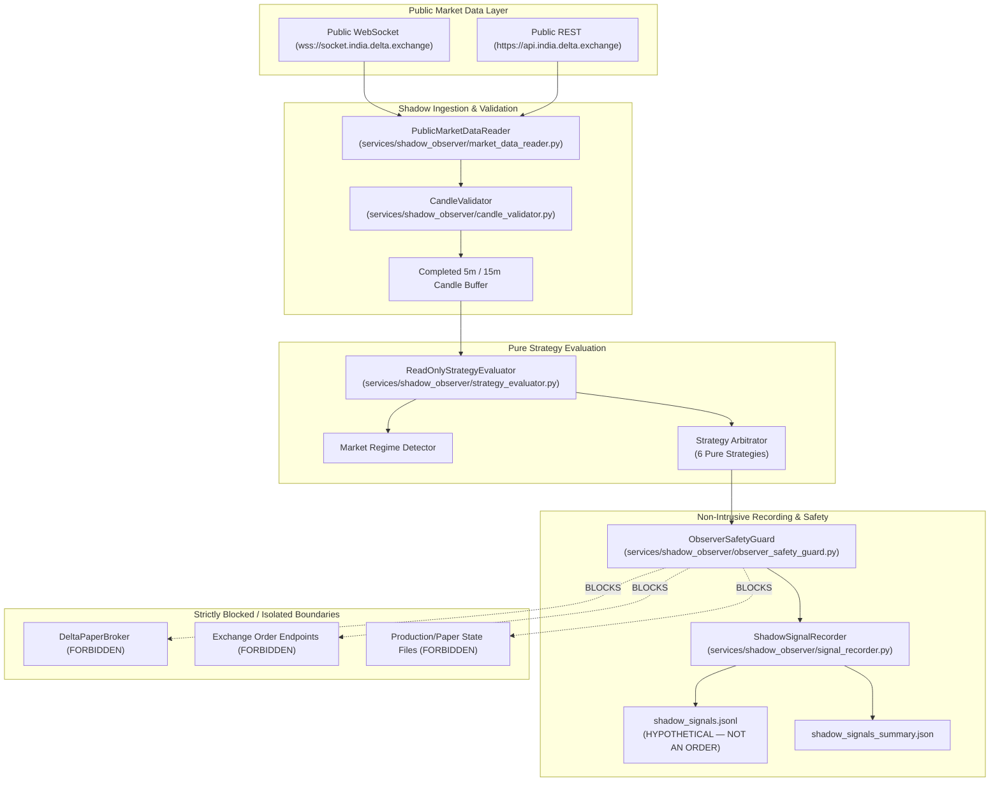

# Phase 3.35 — Read-Only Shadow Observer Architecture

This document specifies the technical design, module boundaries, and isolation guarantees for the read-only shadow observation system designed for XAUTUSD on Delta Exchange India.

---

## 1. Architectural Philosophy & Isolation Invariants

The Shadow Observer is engineered as a **completely detached read-only evaluation pipeline**. It has no operational linkage to order execution, margin accounting, or portfolio cash balances.

---

## 2. Component Specifications

### 2.1 `observer_safety_guard.py`
- **Role**: Fail-closed gatekeeper ensuring zero broker contamination.
- **Enforcement**:
  - `validate_shadow_write_path()`: Validates that file write operations are strictly confined to authorized shadow output directories (`reports/phase3_35_shadow_validation`). Categorically denies writing to production state files (`paper_account_xautusd.json`, `paper_forward_24h_state.json`, `.idempotency.db`, `.env`).
  - `verify_observer_isolation()`: Asserts `TRADING_MODE != LIVE` and `LIVE_TRADING_ENABLED == false`.
  - `block_execution_attempt()`: Unconditionally raises `ShadowObserverSafetyViolation` on any order placement attempt.

### 2.2 `candle_validator.py`
- **Role**: Validates OHLCV structural integrity and enforces the completed-candle invariant.
- **Invariants**:
  - **Incomplete Candle Barrier**: Never evaluates forming or unclosed candles.
  - **Monotonic Timestamp Ordering**: Rejects out-of-order or duplicate timestamps.
  - **Gap Detection**: Identifies and flags missing 5m intervals.
  - **Mathematical Integrity**: Validates $High \ge Low$, $High \ge \max(Open, Close)$, $Low \le \min(Open, Close)$, $Volume \ge 0$.

### 2.3 `strategy_evaluator.py`
- **Role**: Discovers and runs strategy evaluation functions in pure read-only mode.
- **Strategies Evaluated**:
  1. `ORB` (Opening Range Breakout)
  2. `TREND_FOLLOWING` (Multi-Timeframe Trend Following)
  3. `VWAP_EMA` (Intraday VWAP + EMA Confirmation)
  4. `BB_RSI_MEAN_REVERSION` (Bollinger Bands + RSI Mean Reversion)
  5. `ATR_COMPRESSION_BREAKOUT` (ATR Volatility Compression)
  6. `LIQUIDITY_SWEEP` (Liquidity Sweep Reversal)
- **Output**: Produces `ShadowEvaluationEvent` with explicit labeling `HYPOTHETICAL — NOT AN ORDER` and `is_order: false`.

### 2.4 `signal_recorder.py`
- **Role**: Appends evaluation events to a streaming JSONL file and updates aggregate summary metrics.
- **Thread Safety**: Uses internal threading locks to ensure thread-safe writes.
- **Persistence**: Atomic file replacement on summary updates (`.tmp` -> replace).

### 2.5 `market_data_reader.py`
- **Role**: Normalizes public market data streams.
- **Endpoints**: Reuses verified public Delta Exchange India endpoints (`https://api.india.delta.exchange` and `wss://socket.india.delta.exchange`). Operates 100% unauthenticated.
- **Staleness Tracking**: Flags stale market feeds when elapsed time without ticker updates exceeds 60 seconds.

### 2.6 `shadow_report.py`
- **Role**: Compiles recorded JSONL event data into executive summary tables and markdown reports.

---

## 3. Import & Call-Path Isolation Proof

The codebase has been verified via AST and source inspection (`test_11_broker_import_isolation`):
- `services/shadow_observer/` contains **0 imports** of `DeltaPaperBroker`.
- `services/shadow_observer/` contains **0 references** to `open_simulated_trade`, `close_simulated_trade`, or `execute_live_order`.
- Strategy functions in `strategy/` are pure functional evaluators taking `pd.DataFrame` and returning `Signal` dataclasses with zero state mutation.
