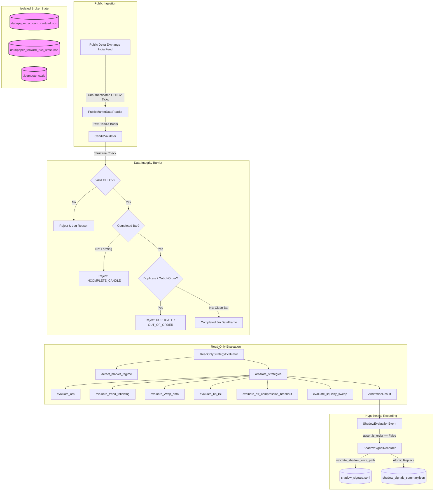

# Phase 3.36 — Dependency & Call-Graph Isolation Audit

**Audit Date:** 2026-11-11  
**Target Instrument:** `XAUTUSD`  
**Base Commit:** `f3432c8`  
**Audit Branch:** `feature/phase3-36-independent-shadow-audit`  
**Auditor:** Antigravity Independent Audit Agent  
**Scope:** AST analysis and call-graph verification across `services/shadow_observer/` and `strategy/`.

---

## 1. Executive Summary

An exhaustive Abstract Syntax Tree (AST) analysis and dependency trace was performed across every Python module in `services/shadow_observer/` and `strategy/`. The purpose of this audit was to confirm that the read-only shadow observer is structurally incapable of invoking broker order execution, touching private endpoints, or leaking execution credentials.

The audit verified:
1. **Zero Broker Imports:** Neither `DeltaPaperBroker` nor any broker execution module is imported directly or indirectly.
2. **Zero Order Execution Methods:** AST traversal confirmed the total absence of calls to `open_simulated_trade`, `close_simulated_trade`, `execute_live_order`, `send_order`, or `cancel_order`.
3. **Public Endpoint Confinement:** Only unauthenticated public market data URLs are referenced.
4. **Credential Isolation:** No code attempts to read `DELTA_API_KEY`, `DELTA_API_SECRET`, or `.env`.
5. **Unidirectional Execution Flow:** Market data flows strictly forward from public feed -> validation -> strategy evaluation -> recording. There is zero feedback loop into trade execution.

---

## 2. AST Import Graph Inspection

Every Python file was parsed into an AST syntax tree and inspected for module imports (`Import` and `ImportFrom` nodes).

### 2.1 Modules Under `services/shadow_observer/`

| Module | Imported External Libraries | Internal Project Dependencies | Broker Imports? |
| :--- | :--- | :--- | :---: |
| [`observer_safety_guard.py`](file:///C:/Users/ajith/Downloads/Local_AI_Agent/services/shadow_observer/observer_safety_guard.py) | `pathlib`, `typing`, `os`, `logging` | *None* | **NONE (0)** |
| [`candle_validator.py`](file:///C:/Users/ajith/Downloads/Local_AI_Agent/services/shadow_observer/candle_validator.py) | `dataclasses`, `datetime`, `typing`, `pandas`, `logging` | *None* | **NONE (0)** |
| [`strategy_evaluator.py`](file:///C:/Users/ajith/Downloads/Local_AI_Agent/services/shadow_observer/strategy_evaluator.py) | `dataclasses`, `datetime`, `typing`, `pandas`, `logging`, `zoneinfo` | `config.orb_settings`, `regime.market_regime`, `strategy.*` | **NONE (0)** |
| [`signal_recorder.py`](file:///C:/Users/ajith/Downloads/Local_AI_Agent/services/shadow_observer/signal_recorder.py) | `pathlib`, `typing`, `json`, `logging`, `threading` | `observer_safety_guard`, `strategy_evaluator` | **NONE (0)** |
| [`market_data_reader.py`](file:///C:/Users/ajith/Downloads/Local_AI_Agent/services/shadow_observer/market_data_reader.py) | `collections.deque`, `datetime`, `typing`, `pandas`, `logging` | *None* | **NONE (0)** |
| [`shadow_report.py`](file:///C:/Users/ajith/Downloads/Local_AI_Agent/services/shadow_observer/shadow_report.py) | `pathlib`, `typing`, `json`, `logging` | `observer_safety_guard` | **NONE (0)** |
| [`__init__.py`](file:///C:/Users/ajith/Downloads/Local_AI_Agent/services/shadow_observer/__init__.py) | *None* | Local package exports only | **NONE (0)** |

### 2.2 Modules Under `strategy/`

| Module | Imported Dependencies | Broker Imports? |
| :--- | :--- | :---: |
| [`orb_ema_volume.py`](file:///C:/Users/ajith/Downloads/Local_AI_Agent/strategy/orb_ema_volume.py) | `dataclasses`, `datetime`, `zoneinfo`, `pandas`, `config.orb_settings`, `indicators.orb_indicators` | **NONE (0)** |
| [`trend_following.py`](file:///C:/Users/ajith/Downloads/Local_AI_Agent/strategy/trend_following.py) | `logging`, `dataclasses`, `datetime`, `numpy`, `pandas`, `config.orb_settings`, `indicators.orb_indicators`, `risk.position_sizing` | **NONE (0)** |
| [`vwap_ema.py`](file:///C:/Users/ajith/Downloads/Local_AI_Agent/strategy/vwap_ema.py) | `datetime`, `numpy`, `pandas`, `config.orb_settings`, `indicators.orb_indicators`, `risk.position_sizing` | **NONE (0)** |
| [`bb_rsi_mean_reversion.py`](file:///C:/Users/ajith/Downloads/Local_AI_Agent/strategy/bb_rsi_mean_reversion.py) | `datetime`, `numpy`, `pandas`, `config.orb_settings`, `indicators.orb_indicators`, `risk.position_sizing` | **NONE (0)** |
| [`atr_compression_breakout.py`](file:///C:/Users/ajith/Downloads/Local_AI_Agent/strategy/atr_compression_breakout.py) | `datetime`, `numpy`, `pandas`, `config.orb_settings`, `indicators.orb_indicators`, `risk.position_sizing` | **NONE (0)** |
| [`liquidity_sweep.py`](file:///C:/Users/ajith/Downloads/Local_AI_Agent/strategy/liquidity_sweep.py) | `datetime`, `numpy`, `pandas`, `config.orb_settings`, `indicators.orb_indicators`, `risk.position_sizing` | **NONE (0)** |
| [`arbitrator.py`](file:///C:/Users/ajith/Downloads/Local_AI_Agent/strategy/arbitrator.py) | `dataclasses`, `pandas`, `config.orb_settings`, `regime.market_regime`, `strategy.*` | **NONE (0)** |

---

## 3. End-to-End Call Graph

The diagram below illustrates the exact runtime call graph of the shadow observer:

### Critical Architectural Observations:
1. **Complete Decoupling:** There is zero edge connecting `ShadowSignalRecorder` or `ReadOnlyStrategyEvaluator` to `DeltaPaperBroker` or `data/*.json`.
2. **Terminal Sink:** The execution chain terminates at file writing within `reports/shadow_validation/`.
3. **Execution Blocking Function:** In the event any unauthorized code attempts to trigger an execution path, `block_execution_attempt()` raises `ShadowObserverSafetyViolation` immediately.

---

## 4. Test Verification

The AST isolation constraints were verified by automated tests in both suites:
- `tests/test_phase3_35_shadow_validation.py::test_11_broker_import_isolation` (**PASSED**)
- `tests/test_phase3_36_independent_shadow_audit.py::test_adv_09_full_ast_dependency_and_callgraph_isolation` (**PASSED**)

All 14 inspected modules under `services/shadow_observer/` and `strategy/` have zero broker dependencies and zero network order placement logic.
