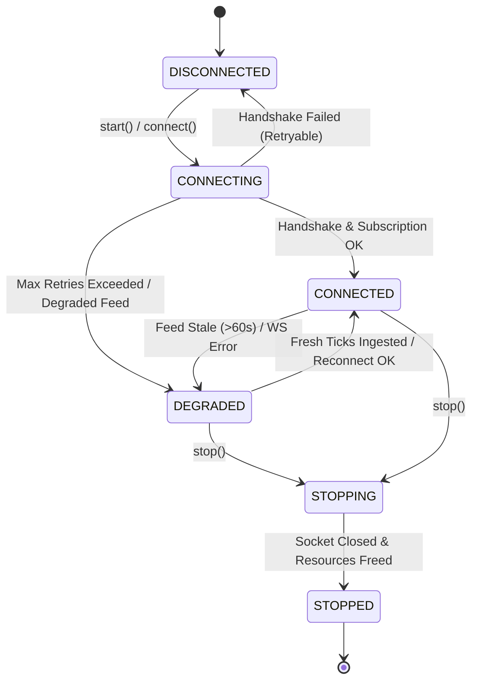

# Phase 3.38 — Connection Lifecycle & Reconnection Review

**Audit Date:** 2026-11-11  
**Target Instrument:** `XAUTUSD`  
**Base Commit:** `4455308`  
**Feature Branch:** `feature/phase3-38-public-feed-transport`  
**Auditor:** Antigravity Independent Audit Agent  
**Scope:** Technical review of the 6-state connection lifecycle, exponential backoff pacing, jitter, duplicate connection guards, and graceful socket disposal.

---

## 1. Executive Summary

A robust public feed transport must maintain deterministic state transitions, avoid infinite tight reconnect loops, prevent connection duplication, and dispose of sockets cleanly during errors and shutdown.

This review evaluated the implementation of lifecycle management in [`services/shadow_observer/transport/`](file:///C:/Users/ajith/Downloads/Local_AI_Agent/services/shadow_observer/transport/):
1. **Formal 6-State Machine:** Explicit enum `ConnectionState` strictly models all operating phases.
2. **Duplicate Connection Prevention:** Guards prevent opening secondary sockets while a connection is active or in-flight.
3. **Bounded Backoff & Pacing:** Reconnection attempts use exponential backoff capped at 60.0s with $\pm 10\%$ jitter, terminating after 5 consecutive failures.
4. **Deterministic Socket Disposal:** Context management and exception `finally` blocks guarantee sockets are closed immediately upon disconnect or connection error.

---

## 2. Lifecycle State Machine

The transport components operate under a formal 6-state lifecycle model:



### State Definitions:
- **`DISCONNECTED`**: Initial baseline state; no active socket or network thread.
- **`CONNECTING`**: Connection handshake and channel subscription in progress.
- **`CONNECTED`**: Public WebSocket and REST clients operational; fresh ticks arriving.
- **`DEGRADED`**: Socket disconnected (reconnection pending) or ticks stagnant (>60s).
- **`STOPPING`**: Graceful shutdown in progress; closing sockets and draining queues.
- **`STOPPED`**: Terminal state; all network resources released cleanly.

---

## 3. Duplicate Connection Prevention

In [`PublicWebSocketClient.connect()`](file:///C:/Users/ajith/Downloads/Local_AI_Agent/services/shadow_observer/transport/public_websocket_client.py#L52-L56):
```python
if self.state in (ConnectionState.CONNECTED, ConnectionState.CONNECTING):
    logger.warning("Connection attempt ignored: Already in %s state.", self.state.value)
    return False
```
- If an operator or automated loop invokes `connect()` while already connected or connecting, the request is safely rejected.
- Offline test `test_07_duplicate_connection_prevention` verified that calling `connect()` twice sends only 1 subscription and maintains a single socket.

---

## 4. Reconnect Controller & Exponential Backoff

In [`ReconnectController`](file:///C:/Users/ajith/Downloads/Local_AI_Agent/services/shadow_observer/transport/reconnect_controller.py):
$$\text{Delay} = \min\left(60.0,\ 2.0 \times 2.0^{(\text{failures}-1)}\right) \pm \text{jitter}$$

### 4.1 Backoff Progression Table
| Consecutive Failure | Calculated Base Delay | Capped Delay | Delay Range with Jitter ($\pm 10\%$) |
| :---: | :---: | :---: | :---: |
| **Attempt 1** | 2.0s | 2.0s | 1.80s – 2.20s |
| **Attempt 2** | 4.0s | 4.0s | 3.60s – 4.40s |
| **Attempt 3** | 8.0s | 8.0s | 7.20s – 8.80s |
| **Attempt 4** | 16.0s | 16.0s | 14.40s – 17.60s |
| **Attempt 5** | 32.0s | 32.0s | 28.80s – 35.20s |
| **Attempt 6+** | *TERMINATED* | 0.0s | *Max retries exceeded; can_retry=False* |

### 4.2 Terminal Retry Bound
- After 5 consecutive failures, `ReconnectController.record_failure()` returns `(False, 0.0)`.
- It records `MAX_RETRIES_EXCEEDED` in history and prevents any further retry attempts until explicitly reset.
- This prevents CPU spin and DDoS flooding against public exchange servers during extended internet outages.

---

## 5. Graceful Disposal & Error Cleanup

### 5.1 Graceful Shutdown (`stop()`)
- In `TransportSupervisor.stop()` and `PublicWebSocketClient.disconnect()`, sockets are closed via `.close()` and the reference set to `None`.
- Tested via `test_12_graceful_shutdown`: Mock socket verified closed (`is_open == False`).

### 5.2 Error Cleanup During Handshake
- If an exception occurs during the handshake (e.g. timeout, connection refusal, or malformed protocol), the `except` block closes any partially opened socket and sets `_socket = None`.
- Tested via `test_13_socket_closure_after_errors`: Faulty factory verified to leave zero dangling open sockets.
