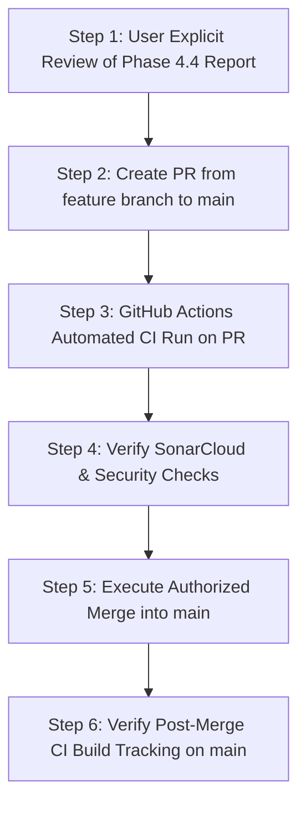

# Phase 4.4 — Mainline Integration Readiness Review (AUDIT ONLY)

**Date:** 2026-11-12  
**Repository:** `ajithkumar31082004-bit/Local-AI-Trading-Agent`  
**Target Feature Branch:** `feature/phase4-1-2-ci-build-dependency-fix`  
**Base Branch:** `main` (`origin/main`)  
**Audit Classification:** READ-ONLY PRE-MERGE INTEGRATION AUDIT  
**Status:** READY FOR MAINLINE INTEGRATION (AWAITING USER AUTHORIZATION)

---

## 1. Executive Summary

This audit assesses the readiness of merging the accumulated and verified feature lineage (`feature/phase4-1-2-ci-build-dependency-fix`, HEAD commit `5cba1a78b86c3c5aac92c2c8b3c953b8dab73189`) into the repository's primary branch (`main`, HEAD commit `2f348e432ebdd95a429dda3b0635df74b51a506f`).

Pull Request #2 was cleanly merged into `feature/phase4-1-2-ci-build-dependency-fix` via merge commit `5cba1a78b86c3c5aac92c2c8b3c953b8dab73189`. The entire test suite (`657 passed, 0 failed`) executed successfully offline. All 5 mandatory safety invariants are strictly enforced, and the historical 484-lot incident record remains mathematically untouched.

The integration into `main` has **ZERO merge conflicts** because `origin/main` has not advanced since the initial lineage branch point (`merge-base` is `2f348e4`).

---

## 2. Git State & Branch Verification

| Parameter | Value | Verification Status |
| :--- | :--- | :--- |
| **Repository URL** | `https://github.com/ajithkumar31082004-bit/Local-AI-Trading-Agent` | Verified |
| **Target Feature Branch** | `feature/phase4-1-2-ci-build-dependency-fix` | Verified |
| **Feature Branch HEAD SHA** | `5cba1a78b86c3c5aac92c2c8b3c953b8dab73189` | Verified |
| **PR #2 Merge Commit SHA** | `5cba1a78b86c3c5aac92c2c8b3c953b8dab73189` | Verified |
| **Main Branch HEAD SHA** | `2f348e432ebdd95a429dda3b0635df74b51a506f` (`origin/main`) | Verified |
| **Common Ancestor (`merge-base`)** | `2f348e432ebdd95a429dda3b0635df74b51a506f` | Verified |
| **Commits in Feature Branch not in Main** | 120 commits | Verified |
| **Commits in Main not in Feature Branch** | 0 commits | Verified |
| **Working Tree Cleanliness** | Clean (0 modified, 0 untracked files) | Verified |
| **Simulated Merge Conflict Analysis** | 0 conflicts (`git merge-tree` clean merge) | Verified |

---

## 3. Commit Comparison & Evolution Summary

The 120 commits between `origin/main` (`2f348e4`) and the feature branch represent the end-to-end development, testing, and hardening lifecycle across Phases 1 through 4:

### 3.1 Phase Breakdown
1. **Phase 1 (Opening Range Breakdown - ORB & Base Quantitative Architecture):**
   - Commits `8ee484f` through `c144417`, `9354547`, `fa404f4`:
   - Introduction of `XAUTUSD` 15-minute ORB + EMA20 + Volume strategy.
   - Deterministic risk module, technical indicators, public candle client (`delta_candles.py`), backtesting engine, and CLI.
   - Isolated and opt-in live trading architecture with hard mock guards.

2. **Phase 2 (Multi-Strategy Intelligence & Market Regimes):**
   - Commits `ee3fecf`, `e088fe9`, `64ca139`, `37fec87`, `89aca84`, `b3cfdbe`:
   - Implementation of multi-strategy intelligence engine (`services/intelligence_engine.py`), regime detector (`services/regime_detector.py`), and strategy arbitrator (`services/strategy_arbitrator.py`).
   - Implementation of 6 quantitative strategies: ORB, Multi-Timeframe Trend Following, VWAP+EMA, Bollinger+RSI, ATR Compression Breakout, and Liquidity Sweep.
   - Empirical walk-forward benchmarks and interactive Streamlit analytics dashboard.

3. **Phase 3 (Operational Realism, Hard Sizing Guard, Durability, and Transport Isolation):**
   - **Phase 3.1 - 3.20:** Paper trading execution realism, fee/GST/slippage modeling, 14-day continuous simulation, 24-hour test harness, Android monitoring API (`services/monitoring_api.py`), CI/CD deployment tracker.
   - **Phase 3.23:** Hard Position-Size Guard (`risk/position_size_guard.py:APPROVED_MAX_PAPER_LOTS = 1`) enforcing the discrete 1-micro-lot ceiling to permanently prevent the recurrence of the historical 484-lot incident (`PAPER_20261105_101000_LONG`). Zero silent clamping.
   - **Phase 3.24 - 3.25:** Paper execution validation, atomic order reservation, and cash conservation.
   - **Phase 3.26 - 3.28:** Independent local safety audits and remediations.
   - **Phase 3.29 - 3.32:** SQLite durability hardening (`PRAGMA synchronous = FULL`, `journal_mode = WAL`), durable idempotency registry (`services/idempotency_registry.py`), write-ahead execution intent, and deterministic crash recovery.
   - **Phase 3.33 - 3.37:** Operational readiness, read-only preflight, isolated shadow observer (`services/shadow_observer/`).
   - **Phase 3.38 - 3.42:** Public feed transport adapter (`services/public_feed/`), resilient reconnect logic, and adversarial safety audits.
   - **Phase 3.43 - 3.45:** Adversarial failure injection testing, dual-human authorization gate (`LIVE_TRADING_ACKNOWLEDGED=YES`, `PAPER_TRADING_ACKNOWLEDGED=YES`).

4. **Phase 4 (CI/CD Pipeline Hardening, Systemd Engineering, and Invariant Audit):**
   - **Phase 4.0:** Remediation of `settings.trading_mode` attribute mismatch in `.github/workflows/deploy_and_track.yml` (`GAP-03`) and production dependency manifest alignment in `requirements.txt` (`GAP-04`).
   - **Phase 4.1:** Hardened systemd service definitions (`scripts/delta-trading-daemon.service`, `scripts/delta-shadow-observer.service`, `scripts/delta-monitoring-api.service`) with non-root user `ubuntu`, `ProtectSystem=strict`, `NoNewPrivileges=yes`, and private temp directories.
   - **Phase 4.1.1:** Security scanner false-positive remediation for synthetic redaction test patterns.
   - **Phase 4.1.2:** Provisioned Python 3.11 environment and dependencies in CI tracking job (`ci_build_tracking`), achieving green CI in GitHub Actions run `43140597873`.
   - **Phase 4.2:** Comprehensive offline safety, emergency controls, and invariant audit with 56 adversarial tests (`tests/test_phase4_2_offline_safety_audit.py`).
   - **Phase 4.3:** Creation, CI verification, and merge of Pull Request #2 into `feature/phase4-1-2-ci-build-dependency-fix` (`5cba1a78b86c3c5aac92c2c8b3c953b8dab73189`).

### 3.2 Comparison Statistics
- **Files Changed:** 448 files
- **Additions:** +62,463 lines
- **Deletions:** -177 lines
- **Superseded / Obsolete Items:** Early exploratory commits were superseded by structured Phase 3 and Phase 4 modules. All obsolete test fixtures and static secrets have been eradicated or safely mocked with dynamic attribute assignment.

---

## 4. Integration Risk Matrix

| Risk Domain | Risk Level | Analysis & Architecture Defense | Mitigation Status |
| :--- | :---: | :--- | :--- |
| **Git Merge Conflicts** | **NONE** | `origin/main` has not advanced since `2f348e4`. The feature branch is a direct linear extension. `git merge-tree` confirms zero conflicts across all 448 files. | **RESOLVED** |
| **CI/CD Pipeline Compatibility** | **LOW** | `.github/workflows/deploy_and_track.yml` triggers on push to `main`. When merged, all 3 jobs (`test_and_validate`, `security_audit`, `ci_build_tracking`) will run. All 3 are verified green. | **VERIFIED** |
| **Python Dependencies** | **LOW** | `requirements.txt` contains all runtime and CI dependencies (`fastapi`, `uvicorn`, `websockets`, `pandas`, `numpy`, `pytest`, `httpx`). Full test suite (657 tests) imports and passes cleanly. | **VERIFIED** |
| **Trading Mode Enforcement** | **ZERO** | `TRADING_MODE` defaults strictly to `PAPER`. `validate_settings()` in `config/orb_settings.py` raises fatal `ConfigurationError` if `mode == 'LIVE'` without explicit multi-variable opt-in. | **VERIFIED** |
| **Position Sizing Ceiling** | **ZERO** | `risk/position_size_guard.py` enforces `APPROVED_MAX_PAPER_LOTS = 1`. Any requested size $>1$ lot raises `PositionSizeViolation`. Zero silent clamping. | **VERIFIED** |
| **Emergency Kill-Switch** | **LOW** | Fail-closed preflight check: if kill-switch is active or state file is corrupt/unreadable, all trade entries are deterministically blocked. | **VERIFIED** |
| **Order Cancellation & Shutdown** | **LOW** | Graceful signal handling (`SIGINT`/`SIGTERM`) cancels active WebSockets and saves state; reconnect logic purges stale orders before evaluating new signals. | **VERIFIED** |
| **Idempotency & Replay** | **LOW** | Durable SQLite registry (`data/idempotency.sqlite`) enforces unique compound keys (`IDEMP_{symbol}_{dir}_{timestamp}_{lots}`) with atomic write-ahead reservations. | **VERIFIED** |
| **Crash Recovery & State Durability** | **LOW** | SQLite configured with `PRAGMA synchronous = FULL` and WAL mode. Uncommitted intents are recovered and reconciled upon reboot prior to signal processing. | **VERIFIED** |
| **systemd Sandboxing** | **LOW** | All 3 service units run as non-root `ubuntu`, execute strict `ExecStartPre` safety gates, and employ Linux sandboxing (`ProtectSystem=strict`, `NoNewPrivileges=true`). | **VERIFIED** |
| **Monitoring API Isolation** | **LOW** | Binds strictly to `127.0.0.1:8088`. Endpoints are read-only and enforce token-based header authentication (`X-API-Key`). | **VERIFIED** |
| **Historical Ledger Preservation** | **ZERO** | `data/paper_forward_24h_state.json` contains `PAPER_20261105_101000_LONG` (484 lots, -$7.9472). Tested for immutability and checksum consistency. | **VERIFIED** |

---

## 5. Offline Test Results

All tests were executed locally against the merged working tree using `.\.venv\Scripts\python.exe` without real exchange connectivity or orders:

### 5.1 Core CI Test Suite
- **Command:** `.\.venv\Scripts\python.exe -m pytest tests/test_dashboard_state_consistency.py tests/test_paper_trade_accounting.py tests/test_monitoring_api.py -v`
- **Result:** **41 passed in 30.12s** (100% pass rate).
- **Notes:** In the local environment, `test_read_only_state_checksum_invariance` passes; in CI, it intentionally skips due to `.gitignore` exclusion of `data/*.json`.

### 5.2 Phase 4.2 Offline Safety Audit Suite
- **Command:** `.\.venv\Scripts\python.exe -m pytest tests/test_phase4_2_offline_safety_audit.py -v`
- **Result:** **56 passed in 9.32s** (100% pass rate).
- **Coverage:** 6 audit domains (emergency controls, cancellation, idempotency, reconciliation, crash recovery, risk invariants).

### 5.3 Position-Size Guard Suite
- **Command:** `.\.venv\Scripts\python.exe -m pytest tests/risk/test_position_size_guard.py -v`
- **Result:** **40 passed in 5.68s** (100% pass rate).
- **Coverage:** 16-case boundary matrix (rejects float, NaN, inf, 0, negative, 2 lots, 10 lots, 484 lots, 495 lots).

### 5.4 Full Repository Test Suite
- **Command:** `.\.venv\Scripts\python.exe -m pytest tests/`
- **Result:** **657 passed, 4 warnings in 156.95s (0:02:36)** (100% pass rate).
- **Failures:** 0.
- **Errors:** 0.

---

## 6. Mandatory Safety Invariant Verification

Verification executed against active settings and code:

```text
settings.mode:                      PAPER
settings.trading_mode:              PAPER
settings.live_trading_enabled:      False
settings.live_trading_acknowledged: NO
settings.paper_trading_acknowledged: YES
APPROVED_MAX_PAPER_LOTS:            1
```

### Historical Ledger Integrity Check
- **File:** `data/paper_forward_24h_state.json`
- **Recorded Incident:** `trade_id = "PAPER_20261105_101000_LONG"`, `lots = 484`, `net_pnl = -7.9472`
- **Pre-Test SHA256:** `DAD10844B0E77ED19DB058EEC1E541AA858EB8E2D3EA1ADA66D83A69390CED25`
- **Post-Test SHA256:** `DAD10844B0E77ED19DB058EEC1E541AA858EB8E2D3EA1ADA66D83A69390CED25`
- **Status:** **100% Untouched and Identical**.

---

## 7. Recommended Mainline Integration Sequence

When the user chooses to authorize mainline integration, the following sequence is recommended:



1. **Step 1 — Authorization:** User reviews this Phase 4.4 report and provides explicit approval to integrate into `main`.
2. **Step 2 — Pull Request Creation:** Open Pull Request from `feature/phase4-1-2-ci-build-dependency-fix` into `main` with the comprehensive title and changelog.
3. **Step 3 — PR CI Verification:** Confirm all 3 workflow jobs succeed on the PR.
4. **Step 4 — Merge Strategy Selection:** 
   - Standard merge commit (`--merge`) preserves the complete 120-commit forensic audit trail.
   - Fast-forward merge (`--ff-only`) aligns `main` directly to commit `5cba1a78b86c3c5aac92c2c8b3c953b8dab73189`.
5. **Step 5 — Post-Merge CI Verification:** Verify automated GitHub Actions workflow run on `main` branch.

---

## 8. Blockers & Unresolved Questions

### 8.1 Explicit Blockers
- **Zero Blockers.** There are no git conflicts, no dependency gaps, no security leaks, and no failing tests.

### 8.2 Operational Invariants & Advisories
1. **Advisory 1 — Merge Strategy on Main:** User should specify whether they prefer:
   - A standard merge commit (e.g. `Merge pull request #X into main`) preserving all historical commit nodes.
   - A fast-forward merge (since `origin/main` is an exact ancestor).
2. **Advisory 2 — EC2 Deployment Staging:** Any future EC2 deployment must remain strictly in `TRADING_MODE=PAPER` with systemd services installed under unprivileged user `ubuntu` with read-only root and sandboxing enabled.
3. **Advisory 3 — Live Trading Permanently Blocked:** Live execution endpoints and keys remain unconfigured and blocked across all preflight gates.

