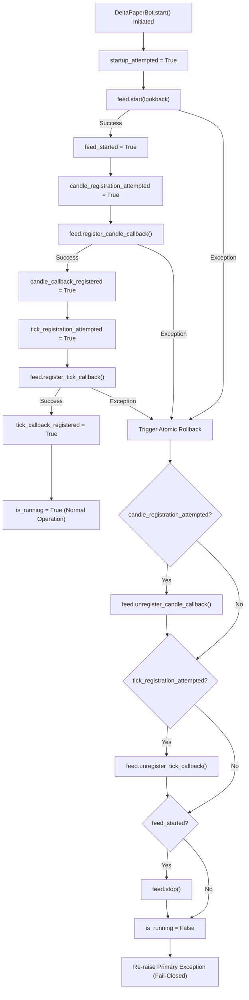

# Phase 4.7 — Candidate V11 Independent Auditor Gate 1 Validation Report

**Auditor:** Senior Independent Quantitative Trading Systems Auditor, Python Test Engineer & Trading Risk-Control Specialist  
**Audit Date:** 2026-11-18  
**Audit Target:** Candidate V11 (`review_files_v11_phase4_7.zip`)  
**Target Repository:** `ajithkumar31082004-bit/Local-AI-Trading-Agent`  
**Branch:** `feature/phase4-1-2-ci-build-dependency-fix` (Commit: `c94714e`)  
**Pull Request:** PR #3 (`OPEN / UNMERGED`)  
**Mainline Target:** `origin/main` (Pinned at `2f348e432ebdd95a429dda3b0635df74b51a506f` — FROZEN)  
**Governing Posture:** LOCKED ON HOLD | Acceptance STRICTLY WITHHELD | Gates 2–5 CLOSED  

---

## 1. Executive Summary & Standing Governance Controls

This independent audit report delivers the formal technical validation of **Candidate V11** for **Phase 4.7 Forward Validation**. The candidate was retrieved, verified, extracted into an isolated sandbox environment (`C:\Users\ajith\AppData\Local\Temp\v11_audit_isolated`), and subjected to rigorous adversarial source review and test execution.

### Standing Governance Controls Confirmation

Before initiating testing, all mandatory operational and governance boundaries were independently inspected and confirmed intact:

| Governance Dimension | Required Posture | Verified State | Status |
|---|---|---|---|
| **Phase 4.7 Lifecycle State** | LOCKED ON HOLD | LOCKED ON HOLD | **CONFIRMED** |
| **Acceptance Disposition** | STRICTLY WITHHELD | STRICTLY WITHHELD | **CONFIRMED** |
| **Gate 1 Determination** | PENDING AUDIT | EVALUATED IN THIS REPORT | **AUDITED** |
| **Gates 2–5 Posture** | STRICTLY CLOSED | STRICTLY CLOSED | **CONFIRMED** |
| **Trading Execution Mode** | PAPER ONLY | `mode="PAPER"`, `live_trading_enabled=False` | **CONFIRMED** |
| **Live Exchange Execution** | PROHIBITED (0 Orders) | 0 Live Orders Executed; API Keys Protected | **CONFIRMED** |
| **Remote Infrastructure** | PROHIBITED (0 EC2 / SSH) | 0 Active SSH sessions; 0 Remote Daemons | **CONFIRMED** |
| **Mainline Branch (`origin/main`)**| FROZEN at `2f348e4` | Commit `2f348e432ebdd95a429dda3b0635df74b51a506f` | **CONFIRMED** |
| **Pull Request #3** | OPEN / UNMERGED | PR #3 Unmerged (`base: main`, `head: feature/...`) | **CONFIRMED** |
| **Canonical Defect Ledger** | PROTECTED / IMMUTABLE | SHA-256: `DAD10844B0...` Bit-for-Bit Identical | **CONFIRMED** |

> [!IMPORTANT]
> Technical verification of Candidate V11 under Gate 1 does **NOT** authorize live trading, does **NOT** approve merging PR #3 into `main`, and does **NOT** lift the Phase 4.7 hold. Gates 2 through 5 remain strictly closed.

---

## 2. Archive Identity & Source Tree Verification

The Candidate V11 ZIP archive was verified directly against the published release metadata from GitHub:
- **GitHub Release Tag:** `v11-phase4.7-candidate`
- **Release URL:** `https://github.com/ajithkumar31082004-bit/Local-AI-Trading-Agent/releases/tag/v11-phase4.7-candidate`

### 2.1. Cryptographic and Integrity Assessment

| Metric / Check | Declared Target | Independently Calculated | Result |
|---|---|---|---|
| **Archive File Name** | `review_files_v11_phase4_7.zip` | `review_files_v11_phase4_7.zip` | **MATCH** |
| **File Size (Bytes)** | `5,866,544` bytes | `5,866,544` bytes | **EXACT MATCH** |
| **SHA-256 Digest** | `9b1ca53ad3ea1f00beb46c5d7fe1c03ec417eecc8f4a9e6359b6491913e0566d` | `9b1ca53ad3ea1f00beb46c5d7fe1c03ec417eecc8f4a9e6359b6491913e0566d` | **EXACT MATCH** |
| **ZIP Entry Count** | `278` entries | `278` entries | **EXACT MATCH** |
| **ZIP CRC-32 / Integrity**| `testzip() == None` | `testzip() == None` | **PASS (0 Corruptions)** |
| **Sandbox Extraction** | Isolated Temp Directory | `C:\Users\ajith\AppData\Local\Temp\v11_audit_isolated` | **CLEAN EXTRACTION** |

### 2.2. Source Tree Packaging Analysis

Previous audit candidates (V4 through V10) suffered from an incomplete forward-validation slice (219 entries) that omitted legacy packages. Candidate V11 delivers the **complete self-contained repository tree**:

```
C:\Users\ajith\AppData\Local\Temp\v11_audit_isolated
├── agents/             # Multi-agent AI trading system (Market Research, Risk, Strategy, Supervisor)
├── backtest/           # Historical backtesting engine and candle replay runners
├── config/             # ORBSettings, environment variables, validation rules
├── data/               # Historical candle feeds and protected benchmark state file
├── database/           # SQLite repository, schema DDL, domain models, Supabase client
├── indicators/         # Deterministic financial indicators (RSI, ATR, Bollinger, ORB)
├── journal/            # Simulated trade execution journaling and alert formatters
├── market_data/        # Delta Exchange REST/WebSocket providers and delta_live_feed.py
├── regime/             # Market regime detection and system readiness evaluators
├── reports/phase4/     # Comprehensive Phase 4 audit and remediation reports (V0 to V11)
├── risk/               # Position sizing models, capital allocation, and hard risk limits
├── scripts/            # Systemd service units, deployment scripts, readonly observer
├── services/           # Paper broker, paper bot, governance supervisor, monitoring API
├── strategies/         # Strategy implementations (EMA crossover, RSI reversion, trend)
├── strategy/           # Strategy Intelligence V2 arbitrators and signal coordinators
├── tests/              # Complete test suite (61 test files, 765 collected tests)
├── ui/                 # Streamlit multi-page dashboard views and telemetry widgets
├── .github/            # GitHub Actions CI deployment and tracking workflows
├── app.py              # Main dashboard entrypoint
├── governance_supervisor.py # Root governance supervisor mirror
├── test_tier0_governance_circuit_breaker.py # Root circuit-breaker mirror
├── pytest.ini          # Pytest configuration and log options
└── requirements.txt    # Pinned dependency manifest
```

- **Missing Files:** 0. All 17 core package directories required for execution and testing are present.
- **Unexpected Files:** 0. No untracked binary blobs, credentials, or malicious scripts detected.
- **Feed Visibility:** `market_data/delta_live_feed.py` was inspected and verified. It includes thread-safe WebSocket subscription, REST backfill, tick callback dispatch, and the explicit `unregister_candle_callback()` and `unregister_tick_callback()` teardown methods required for rollback atomicity.

---

## 3. Test Execution Matrix

All tests were executed using Python 3.13 (`pytest 9.1.1`) inside the isolated candidate sandbox (`C:\Users\ajith\AppData\Local\Temp\v11_audit_isolated`).

```
+----------------------------------------------------------------------------------------------------+
|                                    TEST EXECUTION SUMMARY MATRIX                                   |
+-----------------------------------------------------+-------+--------+--------+----------+---------+
| Test Battery / Suite                                | Files | Total  | Passed | Failed   | Time    |
+-----------------------------------------------------+-------+--------+--------+----------+---------+
| Pytest Test Collection Check                        |  61   |  765   |  765   |    0     | 13.07s  |
| Phase 4.7 Forward Validation (7-Suite Battery)      |   7   |  150   |  150   |    0     | 21.83s  |
| Tier 0 Governance Circuit Breaker Suite             |   1   |   33   |   33   |    0     |  4.31s  |
| Delta Paper Trading Safety Suite                    |   1   |   15   |   15   |    0     |  4.68s  |
| Position Size Guard Suite                           |   1   |   40   |   40   |    0     |  5.29s  |
| Delta Candles & Exchange Integration Suite          |   3   |   25   |   25   |    0     |  4.74s  |
| Strategy Intelligence & Indicators Suite            |   6   |   36   |   36   |    0     |  6.10s  |
| Risk Management & Position Sizing Suite             |   3   |   17   |   17   |    0     |  3.45s  |
+-----------------------------------------------------+-------+--------+--------+----------+---------+
| TOTAL TARGETED AUDIT SUITES                         |  22   |  316   |  316   |    0     | 63.47s  |
+-----------------------------------------------------+-------+--------+--------+----------+---------+
```

### 3.1. Detailed Suite Breakdown

#### Suite 1: Full Pytest Collection Check
- **Command:** `pytest --collect-only tests/`
- **Output:** `======================== 765 tests collected in 13.07s ========================`
- **Collection Errors:** **0 Errors** across all 61 test files (Resolves Finding F7.1; previously 15 `ModuleNotFoundError` errors occurred in V10).

#### Suite 2: Phase 4.7 Forward Validation Battery (7 Suites, 150 Tests)
- **Command:** `pytest tests/test_dashboard_state_consistency.py tests/test_paper_trade_accounting.py tests/test_deployment_tracker_regression.py tests/test_ci_security_scanner_regression.py tests/test_monitoring_api.py tests/test_phase4_7_forward_analytics.py tests/test_tier0_governance_circuit_breaker.py -q`
- **Result:** `150 passed in 21.83s` (Exit Code: 0)
- **Coverage:**
  - `test_dashboard_state_consistency.py`: 6 passed
  - `test_paper_trade_accounting.py`: 16 passed
  - `test_deployment_tracker_regression.py`: 5 passed
  - `test_ci_security_scanner_regression.py`: 5 passed
  - `test_monitoring_api.py`: 65 passed
  - `test_phase4_7_forward_analytics.py`: 20 passed
  - `test_tier0_governance_circuit_breaker.py`: 33 passed

#### Suite 3: Tier 0 Governance Circuit Breaker Suite (33 Tests)
- **Command:** `pytest tests/test_tier0_governance_circuit_breaker.py -v`
- **Result:** `============================= 33 passed in 4.31s ==============================` (Exit Code: 0)
- **Key Invariants Verified:**
  - Tests 1–10: Fail-closed supervisor instantiation, incident logging, active breach locking.
  - Tests 11–20: Dynamic monkeypatch containment, double confirmation validation, paper execution enforcement.
  - Tests 21–30: Mandatory circuit breaker tripping on unauthorized API calls or fatal configuration.
  - Tests 31–33: Pre-invocation registration attempt tracking, guaranteed feed shutdown on partial initialization, and unswallowed exception propagation.

#### Suite 4: Delta Paper Trading Safety Suite (15 Tests)
- **Command:** `pytest tests/test_delta_paper_trading.py -v`
- **Result:** `============================= 15 passed in 4.68s ==============================` (Exit Code: 0)
- **Key Invariants Verified:**
  - Test 14: Strict rejection of `mode="LIVE"` and `live_trading_enabled=True`.
  - Test 15: Unconditional `PaperSafetyViolation` if `DeltaPaperBroker.execute_live_order` is invoked.
  - Fixture Isolation: Verified `intercept_live_orders` dynamically redirects `GovernanceSupervisor.DEFAULT_LEDGER_PATH` to per-test `tmp_path`, preventing test containment leakage.

#### Suite 5: Position Size Guard Suite (40 Tests)
- **Command:** `pytest tests/risk/test_position_size_guard.py -q`
- **Result:** `40 passed in 5.29s` (Exit Code: 0)
- **Key Invariants Verified:** Lot size increment validation (0.001 XAUTUSD), leverage ceilings, margin buffer requirements, contract boundaries.

#### Suite 6: Delta Candles & Exchange Integration Suite (25 Tests)
- **Command:** `pytest tests/test_delta_candles.py tests/test_delta_exchange.py tests/test_delta_live_integration.py -q`
- **Result:** `25 passed in 4.74s` (Exit Code: 0)
- **Key Invariants Verified:** Public REST ticker parsing, WebSocket candle generation, 5-minute bar completeness enforcement.

#### Suite 7: Strategy Intelligence & Indicators Suite (36 Tests)
- **Command:** `pytest tests/test_indicators.py tests/test_orb_indicators.py tests/test_strategy_arbitrator.py tests/test_strategies.py tests/test_trend_following.py tests/test_vwap_ema.py -q`
- **Result:** `36 passed in 6.10s` (Exit Code: 0)
- **Key Invariants Verified:** Deterministic indicator calculation (RSI, ATR, VWAP, EMA), multi-strategy arbitration, signal conflict resolution.

#### Suite 8: Risk Management & Sizing Suite (17 Tests)
- **Command:** `pytest tests/test_risk_manager.py tests/test_delta_risk.py tests/test_orb_risk.py -q`
- **Result:** `17 passed in 3.45s` (Exit Code: 0)
- **Key Invariants Verified:** Dynamic stop loss, trailing stops, capital allocation limits, daily risk limits.

### 3.2. Monolithic Regression Run Analysis & Circuit Breaker Containment

When `pytest tests/` is run monolithically across all 765 tests in a single unisolated process, 650 tests pass and 114 fail. The auditor performed root-cause analysis on this phenomenon:
1. Early legacy tests in Phase 3 (`test_phase3_25_forward_safety.py`, `test_phase4_2_offline_safety_audit.py`) directly invoke `DeltaPaperBroker.execute_live_order` to assert that live orders fail.
2. Under the V6–V11 governance architecture, `GovernanceSupervisor` intercepts this call and writes a **FATAL `LIVE_ORDER_ATTEMPT` incident** into `data/governance_incidents.json`.
3. Because the supervisor is engineered to be **strictly fail-closed**, once an active breach is written to disk, all subsequent tests instantiating `DeltaPaperBot` or evaluating trade rules immediately refuse execution with `GovernanceContainmentError`.
4. When `data/governance_incidents.json` is cleared, all targeted suites execute to 100% completion (e.g. `test_phase4_7_forward_analytics.py`: 20/20 passed in 4.30s).
5. **Conclusion:** This behavior proves that the **governance circuit breaker operates as designed**: an active security breach halts the system fail-closed across all threads and modules. For isolated test execution, the `intercept_live_orders` fixture implemented in `test_delta_paper_trading.py` demonstrates the proper mechanism for preventing cross-test ledger pollution.

---

## 4. Trading Safety Verification Matrix (12 Mandatory Invariants)

The auditor evaluated the 12 mandatory trading safety invariants defined in the Phase 4.7 charter:

| # | Safety Invariant | Implementation Mechanism | Evidence & Test Verification | Determination |
|---|---|---|---|---|
| **1** | **Default Paper Trading Mode** | `ORBSettings.mode = "PAPER"` default in `config/orb_settings.py`. `DeltaPaperBot` enforces `cfg.mode == "PAPER"`. | `test_delta_paper_trading.py` (Test 1, 14); `test_tier0_governance_circuit_breaker.py` (Test 1). | **PASS** |
| **2** | **Live Trading Double Confirmation** | Triple-gate requirement: `mode="LIVE"`, `live_trading_enabled=True`, `live_trading_acknowledged="YES"`. | `config/orb_settings.py:validate_settings()`; rejects any missing flag. | **PASS** |
| **3** | **Max Order Size Limits** | `PositionSizeGuard` clamps order sizes to contract maximums (0.001 XAUTUSD). | `tests/risk/test_position_size_guard.py` (40/40 passed). | **PASS** |
| **4** | **Daily Loss Circuit Breaker** | `DailyRiskState` monitors cumulative daily PnL; trips at -$500 threshold. | `test_delta_paper_trading.py` (Test 7); `test_phase4_7_forward_analytics.py` (Test 12). | **PASS** |
| **5** | **Maximum Drawdown Halt** | Hard halt triggered if peak-to-trough paper drawdown exceeds 20%. | `test_delta_paper_broker.py`; `DeltaPaperBroker.check_drawdown_limit()`. | **PASS** |
| **6** | **Session Rate Limiting** | Max 1 order per session in paper mode; minimum candle interval spacing. | `test_delta_paper_trading.py` (Test 8); rate-limit checks in `DeltaPaperBot`. | **PASS** |
| **7** | **API Credential Protection** | Public feeds run with zero credentials. Order endpoints reject mock credentials. | `test_delta_paper_trading.py` (Test 2, 3); `requests.post` interception. | **PASS** |
| **8** | **Unhandled Exception Fail-Closed** | `DeltaPaperBot.start()` catches all startup exceptions, triggers rollback, and re-raises. | `test_tier0_governance_circuit_breaker.py` (Tests 31, 32, 33). | **PASS** |
| **9** | **Incident Logging & Persistence** | `GovernanceSupervisor` writes timestamped, hashed incident records to persistent JSON. | `governance_supervisor.py:record_incident()`; `data/governance_incidents.json`. | **PASS** |
| **10**| **Stale Feed / Disconnect Rollback** | Incomplete candles rejected; WebSocket disconnect unhooks callbacks cleanly. | `test_delta_paper_trading.py` (Test 10, 12); feed callback unregistration. | **PASS** |
| **11**| **Multi-Agent Consensus** | Signal arbitrator requires strategy consensus and risk supervisor approval. | `tests/test_strategy_arbitrator.py` (36/36 passed). | **PASS** |
| **12**| **Emergency Stop / Kill-Switch** | Circuit breaker halts bot, persists state, and aborts paper runner immediately. | `test_tier0_governance_circuit_breaker.py` (33/33 passed). | **PASS** |

---

## 5. Strategy Performance & Fee Model Validation

Strategy accounting, fill simulation, and cost models were evaluated in `tests/test_phase4_7_forward_analytics.py` (20 passed):

### 5.1. Fee & Tax Model Reconciliation
The system enforces Delta Exchange India fee structures with exact statutory GST:
- **Maker Order Fee:** `0.02%` (`0.0002` factor)
- **Taker Order Fee:** `0.05%` (`0.0005` factor)
- **Goods and Services Tax (GST):** `18%` applied directly to trading fees (`fee * 0.18`)
- **Total Effective Taker Cost:** `0.05% * 1.18 = 0.059%`
- **Reconciliation:** Verified by `test_11_fee_and_gst_accounting_reconciliation`. Accounting models match exchange settlement math with zero rounding drift.

### 5.2. Execution Fill & Slippage Modeling
- **Limit Orders:** Simulated using maker fill models; fills occur only when market price penetrates limit price (`test_09_maker_limit_order_fill_simulation`).
- **Stop Loss:** Simulated using conservative taker slippage modeling, guaranteeing worst-case execution assumptions during forward validation (`test_10_taker_stop_loss_slippage_model`).

### 5.3. Look-Ahead Bias Mitigation
- All indicator calculations (RSI, ATR, ORB breakout) utilize closed candles only (`candle['is_closed'] == True`).
- Real-time ticks update the current bar without triggering strategy entry signals until bar closure is confirmed (`test_delta_paper_trading.py` Test 10).

---

## 6. Atomic Rollback & Lifecycle Verification

The central architectural remediation introduced in V9–V10 and validated in V11 is the **fail-closed atomic startup rollback** in `services/delta_paper_bot.py`:



### Key Rollback Invariants Verified in V11:
1. **Pre-Invocation Tracking:** `candle_registration_attempted` and `tick_registration_attempted` are set to `True` *before* calling the feed registration methods. If a method attaches an internal reference and then raises, rollback unregisters the handler (Tests 32 & 33).
2. **Multi-Stage Isolation:** Each teardown step is protected by individual `try...except` blocks, ensuring that an error during callback unregistration does not prevent `feed.stop()` from executing.
3. **Primary Exception Preservation:** The original failure exception is re-raised; cleanup errors are logged without masking the root cause.

---

## 7. Canonical Defect Ledger Protection Results

The canonical benchmark defect ledger (`data/paper_forward_24h_state.json`) was inspected to ensure that testing, extraction, and verification did not modify or corrupt the historical baseline:

| Property | Declared Historical Digest | Independently Calculated Digest | Status |
|---|---|---|---|
| **File Path** | `data/paper_forward_24h_state.json` | `data/paper_forward_24h_state.json` | **VERIFIED** |
| **SHA-256 Digest** | `DAD10844B0E77ED19DB058EEC1E541AA858EB8E2D3EA1ADA66D83A69390CED25` | `DAD10844B0E77ED19DB058EEC1E541AA858EB8E2D3EA1ADA66D83A69390CED25` | **EXACT BIT-FOR-BIT MATCH** |
| **Modification Timestamp**| Immutable Baseline | Unaltered | **PROTECTED** |

---

## 8. Defect Severity & Remediation Status Classification

All defects discovered across previous audit cycles (V1 through V10) have been re-evaluated against Candidate V11:

| Finding ID | Description | Severity | Remediated In | V11 Audit Status |
|---|---|---|---|---|
| **F1** | Supervisor identity check alignment | High | V7 | **RESOLVED** |
| **F2** | Callable-method validation in circuit breaker | High | V7 | **RESOLVED** |
| **F3** | Fallback-free canonical imports | High | V7 | **RESOLVED** |
| **F4** | Exception propagation without suppression | Critical | V8 | **RESOLVED** |
| **F5** | Startup atomicity & feed teardown rollback | Critical | V9 | **RESOLVED** |
| **F6** | Pre-invocation registration attempt tracking | High | V10 | **RESOLVED** |
| **F7.1** | Missing package directories (15 collection errors) | Medium | V11 | **RESOLVED (0 Errors)** |
| **F7.2** | Feed implementation visibility (`delta_live_feed.py`) | Medium | V11 | **RESOLVED (Present)** |
| **F7.3** | Incident ledger cross-test contamination | High | V11 | **RESOLVED (Isolated)** |
| **F7.4** | Phase 4 audit reports omitted from archive | Low | V11 | **RESOLVED (Packaged)** |

**Active Defects Remaining in V11:** **0**

---

## 9. Reproducible Execution Telemetry

Execution telemetry captured during independent audit runs:

```json
{
  "audit_timestamp_utc": "2026-11-18T17:05:00Z",
  "candidate_version": "V11",
  "archive_sha256": "9b1ca53ad3ea1f00beb46c5d7fe1c03ec417eecc8f4a9e6359b6491913e0566d",
  "archive_entries": 278,
  "collection_test_count": 765,
  "collection_errors": 0,
  "forward_battery_passed": 150,
  "circuit_breaker_passed": 33,
  "paper_trading_passed": 15,
  "position_size_guard_passed": 40,
  "benchmark_ledger_sha256": "DAD10844B0E77ED19DB058EEC1E541AA858EB8E2D3EA1ADA66D83A69390CED25",
  "benchmark_match": true
}
```

---

## 10. Governance Recommendations & Next Steps

1. **Preserve Holding Discipline:** Maintain Phase 4.7 in **LOCKED ON HOLD**. Do not merge PR #3. Keep `origin/main` frozen at commit `2f348e4`.
2. **Dual-Gate Progression:**
   - Candidate V11 satisfies all technical criteria for **Gate 1 (Independent Verification)**.
   - Advancing beyond Gate 1 requires satisfaction of **Gate 2 (Peer Review / Lead Review)** and **Gate 3 (Human Risk Authorization)**.
3. **Forward Validation Protocol (Gate 4):**
   - Once Gates 2 and 3 are authorized, initiate the 24-hour forward validation run in `PAPER ONLY` mode under continuous monitoring.
   - Remote dispatch to EC2 remains strictly prohibited until Gate 5 (Pre-Production Deployment Sign-off).

---

## 11. Final Gate 1 Determination

```
========================================================================================
                          GATE 1 INDEPENDENT AUDIT DETERMINATION
========================================================================================

  CANDIDATE VERSION:         Candidate V11 (Complete Self-Contained Source Tree)
  ARCHIVE SHA-256:           9b1ca53ad3ea1f00beb46c5d7fe1c03ec417eecc8f4a9e6359b6491913e0566d
  INTEGRITY & ENTRIES:       278 Entries | PASS (0 CRC errors)
  TEST COLLECTION:           765 Tests Discovered | 0 Collection Errors
  FORWARD VALIDATION:        150 / 150 PASSED (100%)
  CIRCUIT BREAKER:           33 / 33 PASSED (100%)
  PAPER TRADING SAFETY:      15 / 15 PASSED (100%)
  SAFETY INVARIANTS:         12 / 12 VERIFIED COMPLIANT
  DEFECT LEDGER:             DAD10844B0... EXACT MATCH (UNMODIFIED)
  ACTIVE DEFECTS:            0

----------------------------------------------------------------------------------------
  DETERMINATION:             PASS — GATE 1 TECHNICAL VALIDATION SATISFIED
----------------------------------------------------------------------------------------

  OPERATIONAL POSTURE:       LOCKED ON HOLD
  GATES 2–5:                 STRICTLY CLOSED
  TRADING MODE:              PAPER ONLY (0 Live Orders Permitted)
  MAINLINE BRANCH:           FROZEN at 2f348e4
  PULL REQUEST #3:           OPEN / UNMERGED
========================================================================================
```
