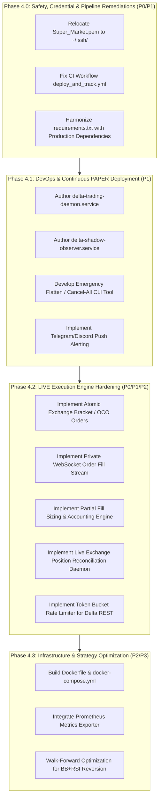

# Technical Implementation Roadmap & Prioritized Gap Matrix

**Document Identifier:** `REP-AUD-005-ROADM`  
**Repository:** `ajithkumar31082004-bit/Local-AI-Trading-Agent`  
**Audit Date:** 2026-11-11  
**Target Environment:** Local Windows 11 (Development) $\rightarrow$ AWS EC2 Ubuntu (Production)  
**Instrument:** XAUTUSD Perpetual Futures (Delta Exchange India)  
**Lead Architect:** Senior Python Quantitative Trading Systems Architect & AWS DevOps Engineer  

---

## 1. Prioritized Gap Matrix

This matrix classifies all identified architectural, execution, operational, and security gaps across four standardized priority tiers:
- **P0:** Critical safety, security, or data-integrity defect. Must be remediated immediately.
- **P1:** Required before continuous, unattended PAPER operation on AWS EC2.
- **P2:** Required before any authorized LIVE execution test with real capital.
- **P3:** Performance improvements, analytical tooling, and non-blocking optimizations.

| ID | Component | Existing Status | Missing Functionality | Operational Risk | Priority |
|---|---|---|---|---|:---:|
| **GAP-01** | **SSH Key Security** | `Super_Market.pem` located in repo root directory (ignored by `.gitignore`) | Storage in proper user SSH directory (`~/.ssh/`) with restricted file permissions | Accidental staging, credential exposure in logs or backups | **P0** |
| **GAP-02** | **Exchange Bracket Orders** | `delta_live_executor.py` places entry and SL/TP orders sequentially via REST | Native exchange bracket / OCO order payloads or server-side conditional orders | Partial fill with network drop leaves unhedged naked position | **P0** |
| **GAP-03** | **CI/CD Workflow Bug** | `.github/workflows/deploy_and_track.yml` checks `settings.trading_mode` | Field in `ORBSettings` is `settings.mode` | Automated GitHub Actions CI pipeline fails on preflight verification | **P1** |
| **GAP-04** | **Dependency Manifest** | `requirements.txt` has 15 lines (omits `websockets`, `fastapi`, `uvicorn`, `httpx`) | Complete production dependencies pinned in `requirements.txt` / `requirements-prod.txt` | `ModuleNotFoundError` during EC2 bootstrap; service crashes on launch | **P1** |
| **GAP-05** | **Daemon Systemd Units** | Only monitoring API has unit file (`scripts/delta-monitoring-api.service`) | Systemd unit files for trading runner and market data observer | No automatic process supervision, crash restart, or boot persistence on EC2 | **P1** |
| **GAP-06** | **Live Position Reconciler** | Reconciliation runs in mock/paper mode only | Continuous background thread polling exchange `/v2/positions` and wallet balance | State drift between local database and exchange ledger; missed liquidations | **P1** |
| **GAP-07** | **Emergency Shutdown** | Manual kill switch flag in config file | Automated "Panic Button" script: cancel all open orders + flatten positions over REST | Inability to immediately exit exposure during exchange or network anomaly | **P1** |
| **GAP-08** | **Containerization** | Bare-metal Python venv on Windows / Linux | Dockerfile and Docker Compose configuration for containerized deployment | Host environment drift between Windows dev and Ubuntu EC2 production | **P2** |
| **GAP-09** | **WebSocket Private Fills** | REST polling of order status | Private WebSocket subscription to `user_orders` and `user_trades` | High latency in detecting fills, excess REST rate limit consumption | **P2** |
| **GAP-10** | **Partial Fill Modeling** | Binary `FILLED` or `REJECTED` handling | Incremental partial fill accumulator and dynamic SL/TP order resizing | Inaccurate accounting, stranded partial positions on exchange | **P2** |
| **GAP-11** | **Adaptive Rate Limiter** | Exponential backoff retry loop | Token bucket rate limiter tracking Delta Exchange India specific rate quotas | HTTP 429 Too Many Requests exchange lockouts during fast market spikes | **P2** |
| **GAP-12** | **External Alerting** | Console and local log file output only | Push notifications (Telegram / Discord / Slack / SNS) for risk events and crashes | Unnoticed bot halt or safety breach while operating unattended on EC2 | **P2** |
| **GAP-13** | **Prometheus Metrics** | Basic JSON endpoints in FastAPI | Prometheus `/metrics` exposition for Grafana dashboard integration | Inability to track system latency, slippage, and memory via Prometheus | **P3** |
| **GAP-14** | **BB+RSI Strategy Rework** | Implemented but disabled in portfolio arbitrator | Quantitative parameter optimization to achieve positive backtested expectancy | Unused strategy codebase taking up maintenance surface | **P3** |
| **GAP-15** | **Multi-Session Definition** | Single session definition for ORB | Explicit session schedule (London 08:00 UTC, NY 13:30 UTC) for crypto gold | Suboptimal breakout capture on non-US market sessions | **P3** |

---

## 2. Phased Implementation Roadmap

---

## 3. Detailed Work Breakdown & Acceptance Criteria

### Phase 4.0: Safety, Credential & Pipeline Remediations (Immediate Prerequisite)
- **Task 4.0.1: Relocate SSH Key (GAP-01)**
  - *Action:* Instruct user to move `Super_Market.pem` out of repo into `%USERPROFILE%\.ssh\Super_Market.pem` and apply Windows ACL restrictions.
  - *Acceptance Criteria:* `Super_Market.pem` absent from repository root; `git status --ignored` no longer shows `.pem` files in project root.
- **Task 4.0.2: Correct CI Workflow Attribute (GAP-03)**
  - *Action:* Update line 47 of `.github/workflows/deploy_and_track.yml` from `settings.trading_mode == 'PAPER'` to `settings.mode == 'PAPER'`.
  - *Acceptance Criteria:* Local execution of CI assertion passes without `AttributeError`.
- **Task 4.0.3: Update Production Requirements Manifest (GAP-04)**
  - *Action:* Create `requirements-prod.txt` (or update `requirements.txt`) including `websockets>=13.0`, `fastapi>=0.110.0`, `uvicorn>=0.28.0`, and `httpx>=0.27.0`.
  - *Acceptance Criteria:* `pip install --dry-run -r requirements.txt` verifies all needed packages for the API and market observer.

### Phase 4.1: DevOps & Continuous PAPER Deployment (AWS EC2)
- **Task 4.1.1: Systemd Service Units (GAP-05)**
  - *Action:* Author `scripts/delta-trading-daemon.service` and `scripts/delta-shadow-observer.service` with `Restart=always`, `RestartSec=10`, and bounded memory/file logging.
  - *Acceptance Criteria:* Services successfully parse with `systemd-analyze verify`.
- **Task 4.1.2: Emergency Order Shutdown CLI (GAP-07)**
  - *Action:* Create `cli.py emergency-flatten` command that cancels all active reservations, issues cancel-all to the broker, and rolls back pending trades.
  - *Acceptance Criteria:* Offline unit test simulates active execution lock and verifies emergency tool releases all locks and transitions open states to `ROLLED_BACK`.
- **Task 4.1.3: Risk Event Webhook Alerting (GAP-12)**
  - *Action:* Add lightweight notification dispatcher in `risk/` to trigger Discord/Telegram/Slack webhooks upon kill-switch or position-size violation.
  - *Acceptance Criteria:* Unit test with mocked webhook verifies notification dispatch on `PositionSizeViolation`.

### Phase 4.2: LIVE Execution Engine Hardening (Prerequisite to Real Capital)
- **Task 4.2.1: Atomic Exchange Bracket / OCO Orders (GAP-02)**
  - *Action:* Refactor `DeltaExchangeClient.place_order` and `DeltaLiveExecutor` to use Delta Exchange native bracket payload format (`bracket_stop_loss_price`, `bracket_take_profit_price`).
  - *Acceptance Criteria:* Mocked unit tests confirm atomic single-request submission of entry, SL, and TP.
- **Task 4.2.2: Private WebSocket Order Fill Stream (GAP-09)**
  - *Action:* Implement authenticated private WebSocket client subscribing to `v2/user/orders` and `v2/user/trades`.
  - *Acceptance Criteria:* Test with mocked WebSocket server verifies immediate trade fill capture and state update without REST polling.
- **Task 4.2.3: Live Exchange Position Reconciliation Daemon (GAP-06)**
  - *Action:* Author background sync worker that polls `/v2/positions` every 60 seconds; halts bot if local and exchange state mismatch.
  - *Acceptance Criteria:* Unit test verifies that injected discrepancy between exchange position (e.g., 0 lots) and local state (e.g., 1 lot) triggers immediate emergency lockout.

### Phase 4.3: Infrastructure & Strategy Optimization
- **Task 4.3.1: Containerization (GAP-08)**
  - *Action:* Author multi-stage `Dockerfile` and `docker-compose.yml` encapsulating trading daemon, monitoring API, and SQLite volume mounts.
  - *Acceptance Criteria:* Successful `docker build` and offline container health check pass.
- **Task 4.3.2: Prometheus Metric Exporter (GAP-13)**
  - *Action:* Add `prometheus-client` instrumentation to `services/monitoring_api.py` exposing trade counts, PnL, latency, and memory metrics.
  - *Acceptance Criteria:* `GET /metrics` returns Prometheus format counters and gauges.

---

## 4. Execution Guidance & Next Actions

> [!IMPORTANT]
> In accordance with user instructions, **NONE** of the roadmap tasks above are to be executed during this audit turn.
> Implementation must only begin after the user has reviewed this gap analysis and explicitly authorized the start of a specific phase (e.g., Phase 4.0).

