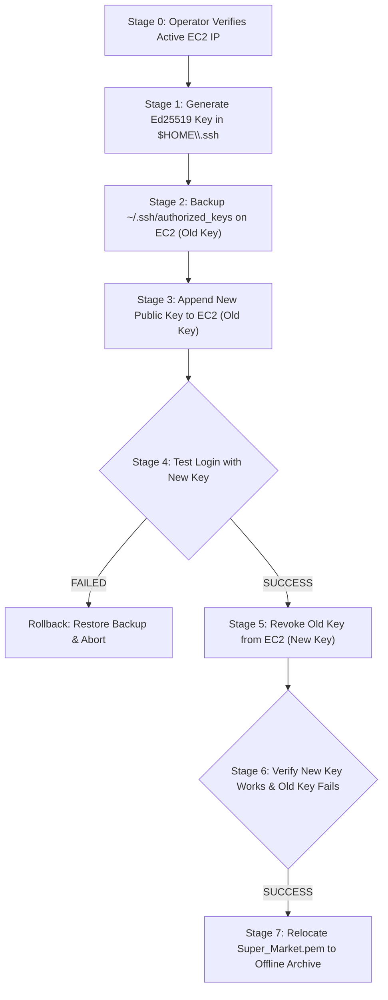

# Phase A2 — SSH Key Rotation Preparation and Safe Execution Plan

**Document Identifier:** `REP-AUD-A2-SSH-ROT`  
**Repository:** `ajithkumar31082004-bit/Local-AI-Trading-Agent`  
**Existing Key:** `C:\Users\ajith\Downloads\Local_AI_Agent\Super_Market.pem`  
**Proposed Replacement Key:** `$HOME\.ssh\delta_trading_ec2`  
**Historical EC2 Target:** `16.4.36.144` (User: `ubuntu`)  
**Audit Date:** 2026-11-11  
**Author:** Senior Git Security Engineer & AWS Infrastructure Security Auditor  
**Phase Status:** Preparation & Plan Only (Execution on Hold)  

---

## 1. Executive Summary

This document establishes the preflight audit results, command-level execution plan, verification gates, and rollback procedures for replacing the legacy `Super_Market.pem` SSH key with a modern, dedicated **Ed25519** keypair stored outside the repository in the user's secure `$HOME\.ssh\` directory.

In accordance with strict safety rules:
- **No external network connections** to EC2 or AWS were initiated during this turn.
- **No keys were generated, deleted, renamed, or modified.**
- **No changes to trading configuration or services were made.**
- Execution remains strictly on hold until explicit human authorization is granted.

---

## 2. Stage 1: Local Environment & Preflight Inspection Results

| Inspection Item | Verification Method | Inspected Reality | Status |
|---|---|---|:---:|
| **Existing Key File** | `Test-Path Super_Market.pem` | File exists at repository root (1,674 bytes, 27 lines, RSA 2048-bit) | **CONFIRMED** |
| **Local SSH Client** | `(Get-Command ssh.exe).Source` | `C:\WINDOWS\System32\OpenSSH\ssh.exe` available | **CONFIRMED** |
| **Local Key Generator** | `(Get-Command ssh-keygen.exe).Source` | `C:\WINDOWS\System32\OpenSSH\ssh-keygen.exe` available | **CONFIRMED** |
| **User `.ssh` Directory** | `Test-Path $HOME\.ssh` | Directory exists (`C:\Users\ajith\.ssh`) | **CONFIRMED** |
| **Replacement Key Check** | `Get-ChildItem $HOME\.ssh` | No existing private keys (`delta_trading_ec2` absent; only `known_hosts` present) | **READY FOR GEN** |
| **Host Fingerprint Record** | `Select-String $HOME\.ssh\known_hosts` | 3 existing host records for historical IP `16.4.36.144` | **CONFIRMED** |
| **Live EC2 IP Verification** | Preflight Boundary Check | Historical IP `16.4.36.144` must be confirmed active before connecting | **PENDING USER CONFIRMATION** |

> [!WARNING]
> **Dynamic IP Notice:** AWS EC2 public IPv4 addresses change upon instance stop/start unless an Elastic IP (EIP) is associated. The Lead Operator must confirm whether `16.4.36.144` is currently active or if the instance has been reassigned a new IP before executing remote commands.

---

## 3. Stage 2: Step-by-Step Rotation Execution Plan

The rotation follows an **Additive-Verification-Revocation** workflow. The existing key is never removed or invalidated until the replacement key is independently proven functional.



---

### Step 0: Set Preflight Variables (PowerShell)
```powershell
# Set confirmed target parameters
$EC2_HOST = "16.4.36.144" # Operator: Update if Elastic IP changed
$EC2_USER = "ubuntu"
$OLD_KEY  = "C:\Users\ajith\Downloads\Local_AI_Agent\Super_Market.pem"
$NEW_KEY  = "$HOME\.ssh\delta_trading_ec2"
$NEW_PUB  = "$HOME\.ssh\delta_trading_ec2.pub"
```

---

### Step 1: Generate Replacement Keypair (Local Windows)
Generate a modern Ed25519 keypair outside the project directory in `$HOME\.ssh`:
```powershell
ssh-keygen.exe -t ed25519 -a 100 -f $NEW_KEY -C "delta-trading-ec2-2026"
```
**Restrict Local File Permissions (Windows ACL):**
Ensure only the current user has read permissions to the new private key:
```powershell
icacls.exe $NEW_KEY /inheritance:r /grant:r "$($env:USERNAME):(R)"
```
- **Expected Outcome:** Files `$HOME\.ssh\delta_trading_ec2` (private key) and `$HOME\.ssh\delta_trading_ec2.pub` (public key) are created with restricted ACL.
- **Verification:** `Test-Path $NEW_KEY` returns `True`.

---

### Step 2: Create Immutable Remote Backup on EC2 (Using Existing Key)
Connect to EC2 using the existing `Super_Market.pem` and create a timestamped copy of `~/.ssh/authorized_keys`:
```powershell
ssh.exe -i $OLD_KEY -o BatchMode=yes -o ConnectTimeout=10 "${EC2_USER}@${EC2_HOST}" `
  "cp -p ~/.ssh/authorized_keys ~/.ssh/authorized_keys.bak.`date +%Y%m%d_%H%M%S` && ls -l ~/.ssh/authorized_keys*"
```
- **Expected Outcome:** A backup file (e.g., `authorized_keys.bak.20261111_233000`) is created with identical permissions (`0600`).
- **Gate:** If this command fails or times out, **STOP**. Do not modify anything.

---

### Step 3: Append Replacement Public Key to EC2 (Using Existing Key)
Read the new public key and append it to `~/.ssh/authorized_keys`:
```powershell
$PUB_CONTENT = (Get-Content $NEW_PUB -Raw).Trim()
ssh.exe -i $OLD_KEY -o BatchMode=yes "${EC2_USER}@${EC2_HOST}" `
  "echo '$PUB_CONTENT' >> ~/.ssh/authorized_keys && chmod 600 ~/.ssh/authorized_keys && wc -l ~/.ssh/authorized_keys"
```
- **Expected Outcome:** The line count of `authorized_keys` increments by exactly 1. Both the old key and the new key are now authorized simultaneously.
- **Safety Guarantee:** The old key remains 100% functional.

---

### Step 4: Independent Verification of Replacement Key
Open a completely separate SSH session using the new private key, explicitly bypassing SSH agent and existing keys:
```powershell
ssh.exe -i $NEW_KEY -o IdentitiesOnly=yes -o BatchMode=yes -o ConnectTimeout=10 "${EC2_USER}@${EC2_HOST}" `
  "echo 'SSH_ROTATION_TEST_SUCCESSFUL' && whoami && hostname && uptime"
```
- **Required Verification Criteria:**
  1. Terminal outputs `SSH_ROTATION_TEST_SUCCESSFUL`.
  2. `whoami` outputs `ubuntu`.
  3. Exit code is `0`.
- **CRITICAL GATE:** If Step 4 fails for **any reason**, execute the Rollback Procedure immediately. **DO NOT PROCEED TO STEP 5.**

---

### Step 5: Revoke Old Key on EC2 (Using Replacement Key)
Connect using the verified new key and remove the old `Super_Market` key from `authorized_keys`:
```powershell
ssh.exe -i $NEW_KEY -o IdentitiesOnly=yes "${EC2_USER}@${EC2_HOST}" `
  "grep -v 'Super_Market' ~/.ssh/authorized_keys > ~/.ssh/authorized_keys.new && mv ~/.ssh/authorized_keys.new ~/.ssh/authorized_keys && chmod 600 ~/.ssh/authorized_keys && cat ~/.ssh/authorized_keys"
```
- **Expected Outcome:** `authorized_keys` contains only the new Ed25519 key line.

---

### Step 6: Post-Revocation Dual Verification
1. **Verify New Key Continues to Work:**
   ```powershell
   ssh.exe -i $NEW_KEY -o IdentitiesOnly=yes -o BatchMode=yes "${EC2_USER}@${EC2_HOST}" "echo 'NEW_KEY_OPERATIONAL'"
   ```
   *Expected Outcome:* Outputs `NEW_KEY_OPERATIONAL`.

2. **Verify Old Key is Actively Rejected:**
   ```powershell
   ssh.exe -i $OLD_KEY -o IdentitiesOnly=yes -o BatchMode=yes "${EC2_USER}@${EC2_HOST}" "echo 'SHOULD_FAIL'"
   ```
   *Expected Outcome:* Fails with `Permission denied (publickey)`.

---

### Step 7: Secure Local Archival of `Super_Market.pem`
Once the new key is fully operational and the old key is revoked:
1. Create a secure archival directory outside the repository:
   ```powershell
   New-Item -ItemType Directory -Force -Path "$HOME\.ssh\archive"
   ```
2. Move `Super_Market.pem` out of the project repository:
   ```powershell
   Move-Item -Path "C:\Users\ajith\Downloads\Local_AI_Agent\Super_Market.pem" -Destination "$HOME\.ssh\archive\Super_Market.pem.revoked_202611"
   ```
3. Verify repository root is clean:
   ```powershell
   Test-Path "C:\Users\ajith\Downloads\Local_AI_Agent\Super_Market.pem" # Returns False
   ```

---

## 4. Stage 3: Rollback & Recovery Procedures

If any failure occurs prior to Step 5:

### Scenario A: New Key Fails Authentication in Step 4
1. **State:** Both keys are currently in `authorized_keys`, but the new key failed to authenticate.
2. **Action:** Connect using the existing key and restore the backup:
   ```powershell
   ssh.exe -i $OLD_KEY "${EC2_USER}@${EC2_HOST}" `
     "LATEST_BAK=\$(ls -t ~/.ssh/authorized_keys.bak.* | head -n1) && cp -p \$LATEST_BAK ~/.ssh/authorized_keys && chmod 600 ~/.ssh/authorized_keys"
   ```
3. Remove the unverified local key:
   ```powershell
   Remove-Item $NEW_KEY, $NEW_PUB -Force
   ```
4. Access remains fully intact via `Super_Market.pem`.

### Scenario B: Remote Network Disconnection During Step 3 or 4
1. Because Step 3 appends rather than overwrites, the original `Super_Market` authorization is never destroyed.
2. Once connectivity restores, reconnect using `Super_Market.pem` and verify `~/.ssh/authorized_keys`.

---

## 5. Remaining Risks and Mitigations

| Risk | Likelihood | Impact | Mitigation |
|---|:---:|:---:|---|
| **EC2 Public IP Changed** | High | High | Operator must verify public IP in AWS Console before issuing Step 0. |
| **Operator Lockout** | Very Low | Critical | Strict gate: Old key is never revoked until new key is proven in an independent session. |
| **Local File Permissions** | Low | Medium | Enforced `icacls` restricts new key to current user on Windows. |
| **Repository File Leak** | Zero | High | New key generated directly in `$HOME\.ssh\`, completely outside the repository tree. |

---

## 6. Execution Boundary Confirmation

**No commands in Section 3 were executed during this turn.**  
All commands are documented for human review and will only be executed when the user explicitly provides authorization.

